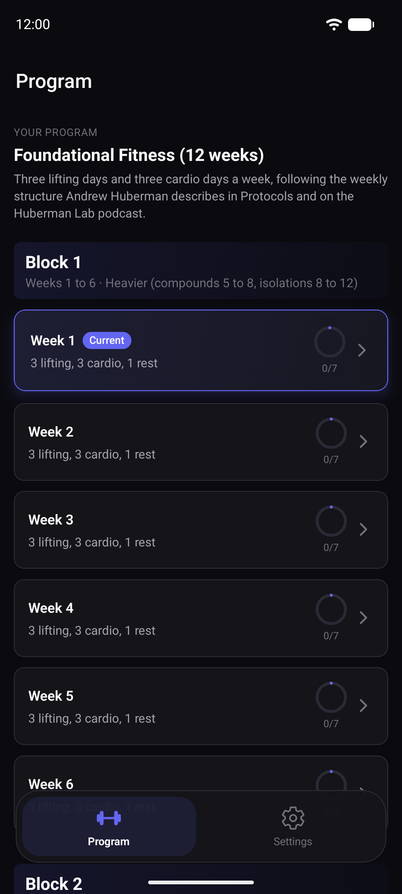
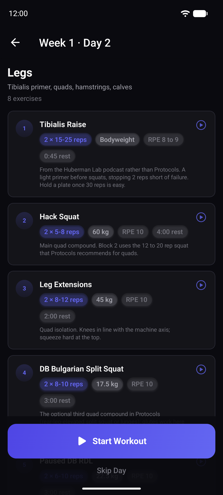
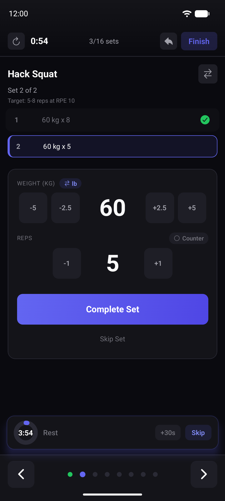
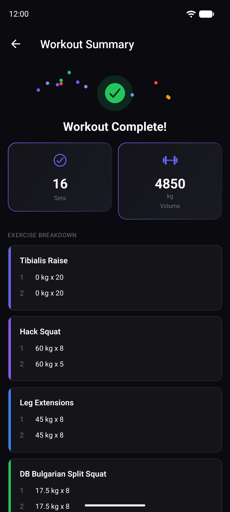
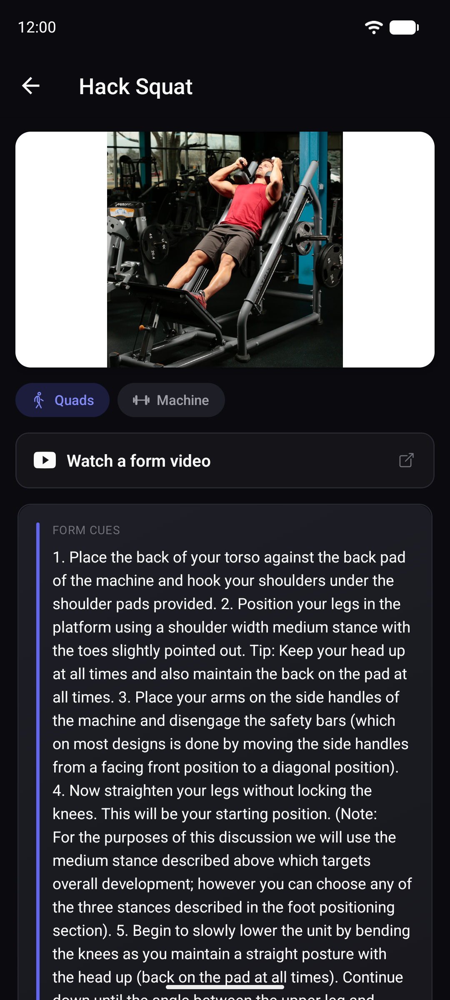

# PlateClimb

**The Foundational Fitness protocol as a free, offline workout app for Android and iOS.**

<p>
  
  
  
  
  
</p>

PlateClimb ships one program, **Foundational Fitness (12 weeks)**, which
follows the weekly structure Andrew Huberman describes in his book
*Protocols* and on the Huberman Lab podcast: three lifting days, three cardio
days and a rest and mobility day every week. Open the app and Week 1 is
ready. It logs every set and pre-fills your weights, and everything stays on
your phone. No account, no server, no sync, no backup, no AI, no
subscription, no ads, no tracking.

For the cardio days, pair it with [BaseMile](https://github.com/likwiid/basemile),
a free heart rate running coach from the same team that also runs entirely on
your phone.

## The program

- **12 weeks in three parts.** Block 1 (weeks 1 to 6) is heavier: compounds
  for 5 to 8 reps, isolations for 8 to 12. Block 2 (weeks 7 to 11) moves to
  higher reps. Week 12 is a week off from lifting: stay active, no weights.
- **Every week:** Long cardio, Legs, Rest and mobility, Torso, Medium cardio,
  Intense cardio, Shoulders and Arms. Cardio and rest days show what to do
  (duration and effort) and have no lifts to log.
- **Every lift is prescribed:** working sets, rep range, target effort (RPE),
  rest time, a starting weight and a short coaching note. Timed carries count
  seconds, and bodyweight moves have no weight to fill in.
- **Substitutions.** Each exercise comes with two alternatives for when a
  machine is busy or missing. Swap during the workout and your history follows
  the exercise you actually did.

## Features

- **Pre-filled weights, no surprises.** The first time, a set starts at the
  program's starting weight. After that it starts at what you lifted last
  time. Nothing goes up on its own: you add weight when you are ready.
- **Fast set logging.** Plus and minus steps, a rest timer with
  notifications, a rep counter and personal record cards.
- **Form help.** Most exercises have a photo, and every one links to a form
  video that opens in YouTube.
- **kg or lb**, with per-exercise switching and plate-sized increments.
- **Optional add-ons.** Add a forearm or stretching block to any lifting day.
- **About 900 exercises** in the catalog, with muscle groups, instructions
  and photos.
- **Fully offline.** The program, your workouts and your records live in a
  SQLite database on the device. The only download is an exercise photo when
  you open an exercise.

The starting weights are a reasonable example for a trained adult, not a
prescription for you. Change any weight on the first session and the app
remembers it from then on.

## Why it's free

I built PlateClimb to follow this protocol myself, and I think a good
training plan should not sit behind a subscription. Following a fixed weekly
plan, logging sets and remembering last week's weights is simple work that a
phone can do offline. So the code is open, the app needs no account or
server, and anyone can read it, change it and share it under the GPL.

If it helps you train consistently, that is the whole point.

Gabriel, [Likwiid](https://likwiid.com)

## Quick start

Requirements: Node 20 and npm, plus the Android SDK and a phone or emulator,
or Xcode for iOS.

```bash
git clone https://github.com/likwiid/plateclimb.git
cd plateclimb
npm ci
```

Check that everything is in order:

```bash
npm run typecheck
npm run lint
npm test
```

### Run on Android or iOS

PlateClimb uses native modules (notifications, SQLite), so it does not
run in Expo Go. Build a development client once:

```bash
npm run android   # or: npm run ios
npm start         # starts Metro for the dev client on later sessions
```

On first launch the app sets up the exercise catalog and the program on the
device and opens straight into Week 1. **Settings, Reset All Data** deletes
your history and sets the program up fresh.

## Privacy

PlateClimb is fully offline. There is no account, no server, no sync, no
backup, no AI service and no analytics, and all your data stays on the phone. The only thing
the app downloads is **exercise photos**, loaded from the public
[free-exercise-db](https://github.com/yuhonas/free-exercise-db) repository on
GitHub (`raw.githubusercontent.com`) when you open an exercise. Nothing is sent
with that request, and offline a placeholder is shown instead. Tapping
**Watch a form video** hands a YouTube link to your phone, which opens it in
the YouTube app or your browser.

## Architecture

PlateClimb is an Expo SDK 54 / React Native app in strict TypeScript:
expo-router screens, Zustand stores and SQLite through expo-sqlite. The
program data, weight pre-fill and exercise photo lookup are pure modules with
unit tests.

```
app/              screens (Program, Settings, week, day, workout, summary, exercise)
src/data/         the bundled program, the exercise catalog and photo lookup
src/features/     program, workout, exercise, settings
src/shared/       db (schema, repositories, seeding), services, stores, UI
scripts/          build-program-data.mjs, which generates the program data
```

See [ARCHITECTURE.md](ARCHITECTURE.md) for the data model and how the program
is seeded.

## Roadmap

Ideas, not promises. Issues and pull requests are welcome.

- Optional automatic progression that you switch on, for people who want the
  app to suggest the next weight.
- Charts for lifts and volume over time.
- Supersets in the workout screen (the data model already has a superset
  group per exercise).
- More testing and polish on iOS.
- Translations.

## Contributing

Read [CONTRIBUTING.md](CONTRIBUTING.md) and the
[Code of Conduct](CODE_OF_CONDUCT.md). Security issues go to the address in
[SECURITY.md](SECURITY.md), not to public issues. Changes are listed in
[CHANGELOG.md](CHANGELOG.md).

## License

PlateClimb is free software: you can redistribute it and modify it under the
terms of the GNU General Public License as published by the Free Software
Foundation, either version 3 of the License, or (at your option) any later
version (**GPL-3.0-or-later**). See [LICENSE](LICENSE) for the full text.
Each source file carries the SPDX identifier `GPL-3.0-or-later`.

Copyright (C) 2026 Gabriel Ghoussoub.

## Credits

- **Andrew Huberman**, whose book *Protocols* and Huberman Lab podcast
  describe the weekly structure of lifting, cardio and rest days that the
  program follows. The exercise choices, sets, reps, starting weights and
  notes are PlateClimb's own reading of that structure, not an official
  program.
- Form videos belong to their creators on YouTube. PlateClimb only links to
  them.
- **[free-exercise-db](https://github.com/yuhonas/free-exercise-db)** by
  yuhonas and **[wrkout/exercises.json](https://github.com/wrkout/exercises.json)**,
  both released under the Unlicense, for the exercise catalog and photos.
- The open source projects PlateClimb is built with, including Expo, React
  Native, expo-sqlite, NativeWind, Reanimated, Notifee and Zustand.

## Disclaimers

PlateClimb is an independent project. **It is not affiliated with or endorsed
by Andrew Huberman or Huberman Lab**, nor by any of the creators or projects
credited above. Names are used only to describe where the weekly structure
comes from.

**Not medical advice.** PlateClimb gives training suggestions for general
fitness only. Talk to a doctor or a qualified coach before starting a new
training programme, learn each lift with good form, and stop if something
hurts.

## Built by Likwiid

PlateClimb is built and maintained by [Likwiid](https://likwiid.com).
